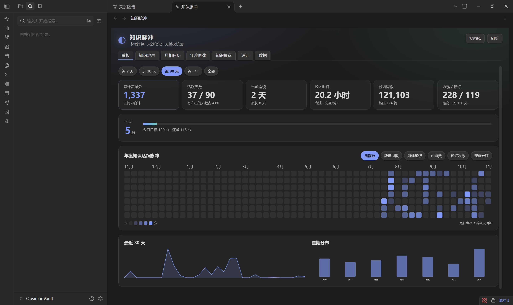
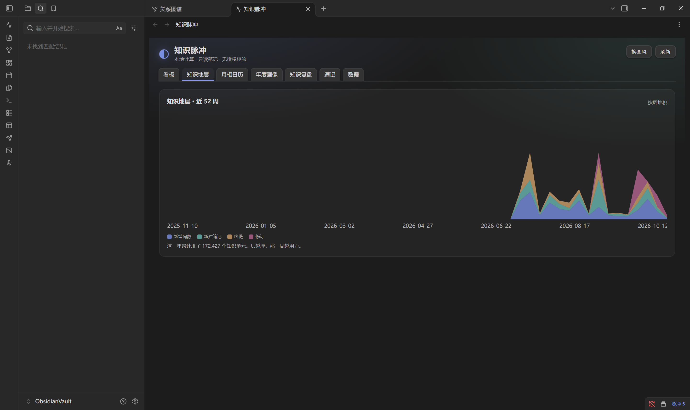
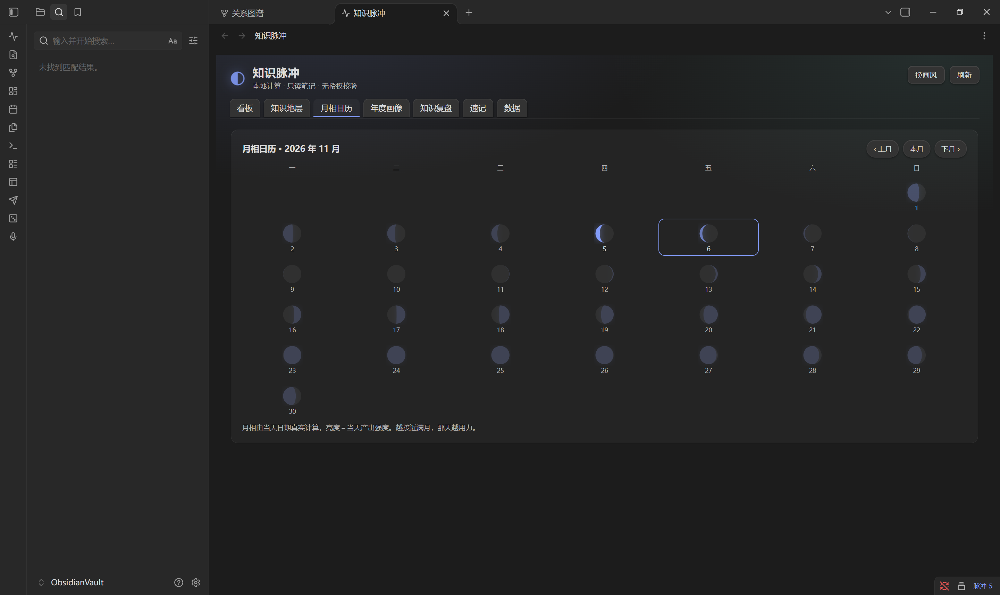
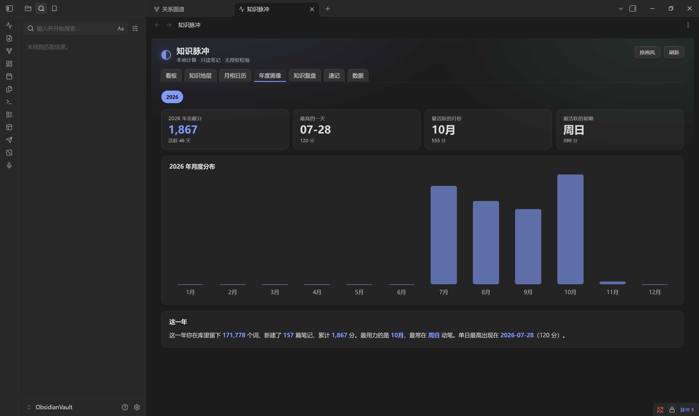
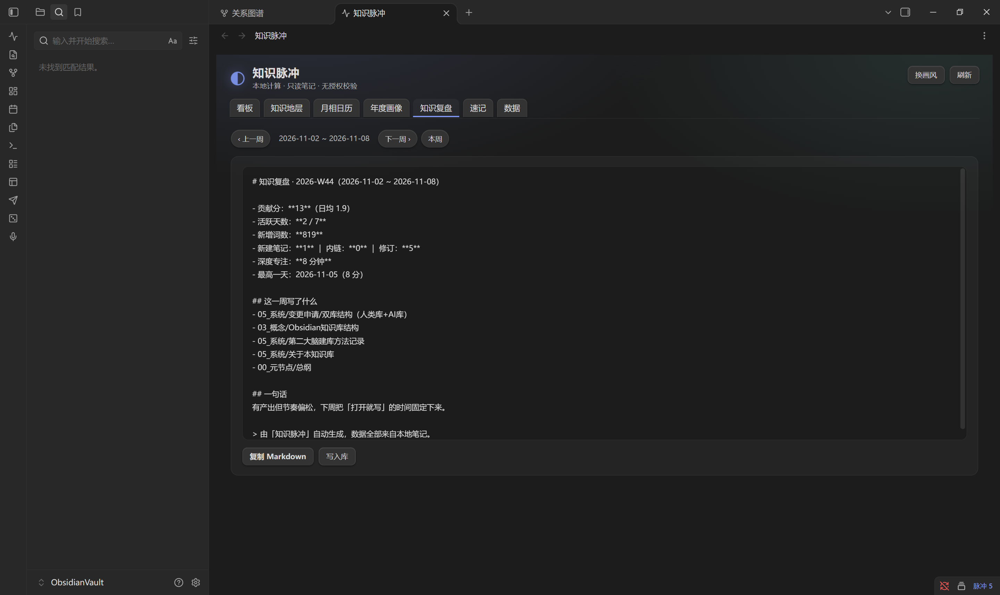
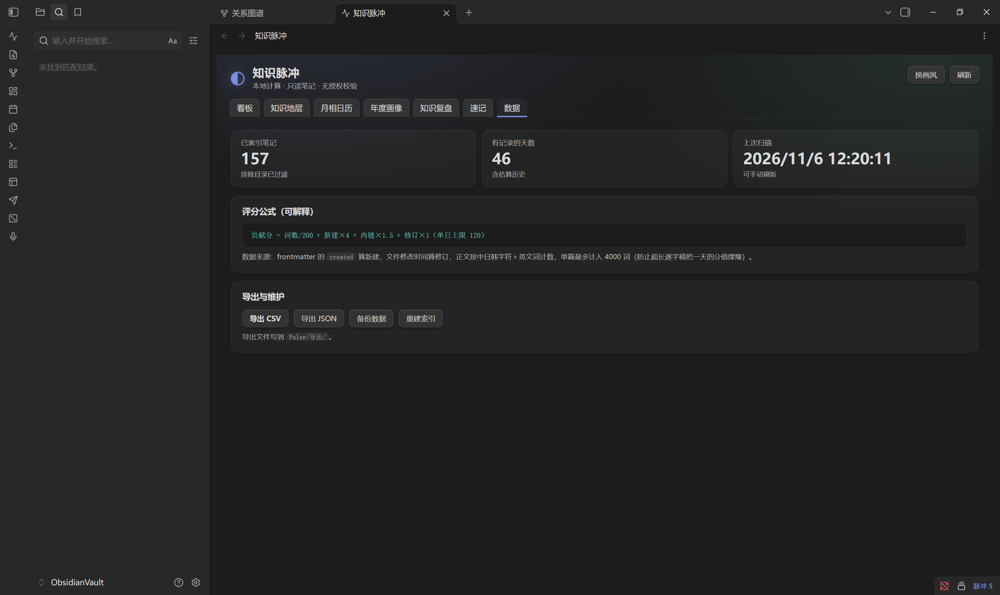
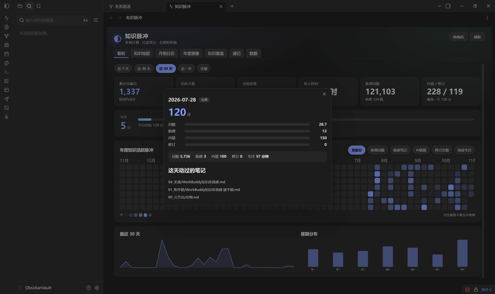

# Pulsewright · 知识脉冲

**你的知识，有自己的脉搏。**

<sub>Obsidian · 全本地计算 · 零授权校验 · 只读笔记</sub>

<br clear="left" />

[](LICENSE)
[](https://github.com/yhjes2019/pulsewright/releases)
[](https://obsidian.md)
[](tests/kp_test.js)
[](#数据与隐私约定)
[](#数据与隐私约定)

**中文** ｜ [English](#english)

给你的 Obsidian 库做一次体检：**贡献分、年度热力图、知识地层、月相日历、年度画像、知识复盘、笔记地图、笔记洞察、速记、分享卡**，全部在本地算完，不联网、无授权码、只读你的笔记。

> 所有数字都从你自己的 Markdown 里算出来，评分公式写在明面上，权重可改；数据只落在本库的 `Pulse/` 目录里，删掉即干净。




---

## 目录

- [它算什么](#它算什么)
- [快速开始](#快速开始)
- [安装](#安装)
- [打开](#打开)
- [评分公式](#评分公式)
- [设置项](#设置项)
- [命令](#命令)
- [数据落在哪](#数据落在哪)
- [数据与隐私约定](#数据与隐私约定)
- [兼容性与版本](#兼容性与版本)
- [语言与本地化](#语言与本地化)
- [已知限制](#已知限制)
- [FAQ](#faq)
- [开发](#开发)
- [许可](#许可)
- [English](#english)

---

## 它算什么

九个标签页，每个都是一次「回头看」：

| 标签 | 你能看到什么 |
|---|---|
| **看板** | 累计贡献分、活跃天数、当前/最长连续、投入时间、词数、新建、内链/修订、年度热力图（6 种指标可切）、近 30 天曲线、星期分布、最厚重的笔记（可点击打开） |
| **知识地层** | 近 52 周按周堆叠的四层面积图（词数 / 新建 / 内链 / 修订），一眼看出哪一周最用功 |
| **月相日历** | 每天一个月亮，亮度 = 当天产出强度；接近满月就是高产日。可翻上月 / 本月 / 下月 |
| **年度画像** | 年度贡献分、最高一天、最活跃月份、最活跃星期、月度柱状图、年度小结 |
| **知识复盘** | 本周 vs 上周对比（涨跌胶囊 + 四项并排）、自动生成周报 Markdown，可复制或直接写进库 |
| **笔记地图** | 标签云、目录分布、孤儿笔记（没人链进来）、断链（链到不存在的笔记）、久未更新（可设阈值）；支持按标题/路径找笔记，一键把地图写成 Markdown 存进库 |
| **洞察** | 写作时段（7×24 网格）、健康度分布（A/B/C/D 四档）、最该补的笔记、近似重复标题、标签共现 |
| **速记** | 随手记，回车保存并追加到 `Pulse/速记.md`；支持搜索、逐条编辑、删除、一键导出 |
| **数据** | 已索引笔记数、有记录天数、评分公式、导出 CSV / JSON / 完整备份、重建索引、**分享卡**（PNG / SVG / 文案） |

时间范围可切 **近 7 天 / 近 30 天 / 近 90 天 / 近一年 / 全部**；热力图指标可切 **贡献分 / 新增词数 / 新建笔记 / 内链数 / 修订次数 / 深度专注**。

看板底部还有一张「今日回顾」卡：每天从「写了 50 词以上、且超过 30 天没动」的笔记里挑一篇出来，提醒你回去补一句——同一天刷新不会换人，隔天自动换。

<details>
<summary>更多截图</summary>

**知识地层**



**月相日历**



**年度画像**



**知识复盘**



**数据页**



**每日明细**（点热力图任意一格）



</details>

## 分享卡

「数据」页最下面有一张分享卡：点「导出分享卡」，会在 `<数据目录>/导出/` 生成一张 **1080×1440 的 PNG** 和一份同版 SVG；点「复制分享文案」，会把同一组数字写成一段话放进剪贴板（剪贴板不可用时写成 `.txt`）。

卡片上只有这些：区间名与截止日、累计贡献分、活跃天数、新增词数、新建笔记、当前连续、每日节奏柱状图、最好的一天。

**它不含任何一条笔记的标题或正文**——分享出去的是你的节奏，不是你的内容。区间跟着面板当前的选择走（近 7 天 / 30 天 / 90 天 / 一年 / 全部），换成哪个区间就出哪个区间的卡。

PNG 是 Obsidian 里用 canvas 现场转出来的，不用装任何东西；万一转换失败，SVG 会保留下来并提示你。

## 快速开始

三步，两分钟：

1. 把插件放进 `<你的库>/.obsidian/plugins/`（[下载安装包](https://github.com/yhjes2019/pulsewright/releases)：Windows 双击 `.exe` 自动装；其他系统解压 `.zip` 拖文件夹。详见下面「安装」）
2. Obsidian → 设置 → 第三方插件 → 关闭「安全模式」→ 启用 **Pulsewright**
3. 点左侧 ribbon 的「打开 Pulsewright」，或命令面板执行 `Pulsewright: 打开 Pulsewright 面板`

首次打开会全库扫描一次。笔记多的库（1000+ 篇）大约几秒到十几秒，扫描期间面板显示「扫描中…」。

## 安装

插件还没上 Obsidian 社区市场，所以要手动放进库目录。下面挑一种，两个包都在 [Releases](https://github.com/yhjes2019/pulsewright/releases) 里。

### 方式一：运行安装程序（Windows，最省事）

下载 **`Pulsewright-Setup-1.0.1.exe`**，双击运行。它会自动读出你电脑上所有 Obsidian 笔记库并列出来，选中一个点「安装到这个库」就装好了。列表里没有你的库，就点「浏览其他库…」自己选文件夹。

装完打开 Obsidian → 设置 → 第三方插件 → 关掉「安全模式 / 受限模式」→ 启用 **Pulsewright**。Obsidian 已经开着的话按 `Ctrl + R` 重新加载。

> 没有数字签名，Windows SmartScreen 可能拦一下：点「更多信息」→「仍要运行」。安装器只做一件事——把三个文件复制进你选的库的 `.obsidian/plugins/pulsewright/`，不写注册表、不装服务、不改系统设置。

### 方式二：解压压缩包（Windows / macOS 通用）

下载 **`pulsewright-1.0.1.zip`**，解压得到一个 `pulsewright` 文件夹，里面是插件本体和一份《安装说明.txt》。

1. 打开你的笔记库目录（就是放 `.md` 文件的那个文件夹）。
2. 进 `.obsidian/plugins/`（没有 `plugins` 就自己新建一个）。
3. 把整个 `pulsewright` 文件夹拖进去，最终长这样：`<你的库>/.obsidian/plugins/pulsewright/manifest.json`
4. Obsidian → 设置 → 第三方插件 → 关掉「安全模式 / 受限模式」→ 启用 **Pulsewright**。

> `.obsidian` 是隐藏文件夹。Windows 在资源管理器里勾「显示隐藏的项目」；macOS 在 Finder 里按 `Cmd + Shift + .`。
> 如果整个库都没有 `.obsidian`，先在 Obsidian 里点开一次「设置 → 第三方插件」，它会自动建出来。

### 方式三：自己拉源码

```bash
# 1. 下载本仓库
git clone https://github.com/yhjes2019/pulsewright.git

# 2. 拷进你的库（注意目录名必须是 pulsewright，和 manifest.json 的 id 一致）
cp -r pulsewright <你的库>/.obsidian/plugins/pulsewright

# 3. 在 Obsidian 里启用
#    设置 → 第三方插件 → 关闭「安全模式」→ 启用「Pulsewright」
```

Windows PowerShell：

```powershell
Copy-Item -Recurse .\pulsewright "$env:USERPROFILE\Documents\你的库\.obsidian\plugins\pulsewright"
```

不需要 `npm install`，没有构建步骤，也没有任何第三方运行时依赖 —— 全文只有一句 `require('obsidian')`。

### 用 BRAT

装了 [BRAT](https://github.com/TfTHacker/obsidian42-brat) 的话，添加仓库地址 `yhjes2019/pulsewright` 即可，后续更新走 BRAT 的「Check for updates」。

### 卸载

在设置里禁用插件后，删掉 `.obsidian/plugins/pulsewright/` 目录即可。**你的笔记一篇都不会少**——插件只读笔记，写出的东西只在 `data.json` 和 `Pulse/` 目录里，这两处你手动删也行。

## 打开

- 左侧 ribbon 图标「打开 Pulsewright」
- 命令面板：`Pulsewright: 打开 Pulsewright 面板`
- 状态栏常驻「脉冲 N」＝ 今日得分
- 插件加载后每 **15 分钟**自动重扫一次；库内文件有变动（`trackLive` 开启时）会即时更新当天记录

## 评分公式

```
贡献分 = 词数 / 200 + 新建 × 4 + 内链 × 1.5 + 修订 × 1      （单日上限 120）
```

| 项 | 怎么算 | 细节 |
|---|---|---|
| **词数** | 正文里的中日韩字符逐个算，英文/数字按词算 | 单篇最多计 **4000** 词 |
| **新建** | 当天新建的笔记数 | 按 frontmatter 的 `created` 算，没有就退回 `date`，再退回文件创建时间——这样从别处导入的笔记也能归到正确的那天 |
| **内链** | 正文里 `[[wikilink]]` 的数量 | 匹配 `[[...]]`，单条最长 200 字符 |
| **修订** | 当天修改过的笔记数 | 按文件修改时间算 |
| **单日上限** | 默认 120 分 | 防止某一天因批量导入异常膨胀 |

**权重可在设置里改**（默认 `{ wordsPerPoint: 200, note: 4, link: 1.5, revision: 1 }`，代码里 `WEIGHTS` 是这套默认值的来源）。设置面板的「评分权重」四项改完立即全库重算，数据页展示的公式串会同步跟着变——公式始终可核对，不会悄悄漂移。

**专注时长分两种来源**，在每日明细弹窗里如实标注：

- **时长实测**：插件运行时监听库内文件的编辑事件，把间隔小于「编辑会话间隔」（默认 5 分钟）的连续编辑合并成一段会话，算出真实跨度。这是真实投入时间。
- **时长估算**：没有会话数据的日期按 `focusSec = 词数 × 0.6 秒`（上限 6 小时）反推，`interactSec = 新建×180 + 修订×90 + 内链×60` 秒。插件未运行时产生的编辑无法补记，只能估算。

导出的 `quality` 列标 `measured` / `estimated`，对应弹窗里的两种徽标。

## 设置项

「设置 → Pulsewright」里能改的，全部在这：

| 设置 | 默认 | 作用 |
|---|---|---|
| 单日贡献分上限 | `120` | 超过部分不再累加 |
| 单篇计入词数上限 | `4000` | 超长逐字稿只按这个上限计分 |
| 排除目录 | `.obsidian, .trash, templates` | 逗号分隔，按路径前缀匹配 |
| 排除 frontmatter 字段 | 空 | 逗号分隔；带这些字段的笔记不计入统计。键名大小写不敏感，值为 `false` / `0` / `no` / 空视为未设置 |
| 历史保留天数 | `0` | `0` = 永久保留；正整数则只留最近 N 天，扫描结束时裁掉更早的日条目与会话段 |
| 编辑会话间隔（分钟） | `5` | 间隔内的连续编辑算同一段会话，用于实测专注时长 |
| 评分权重 | `200 / 4 / 1.5 / 1` | 词数折算、新建、内链、修订四项，改完立即重算全库 |
| 数据目录 | `Pulse` | CSV/JSON、复盘、速记、导出写到这（相对库根） |
| 画风 | `像素` | `像素 / 水墨 / 极简 / 星图` 四套配色，面板头部「换画风」按钮也能切 |
| 导出 JSON 时包含设置项 | 关 | 默认脱敏；开了才把 `settings` 一起写进 JSON |
| 备份时包含速记正文 | 关 | 默认脱敏；开了完整备份才含 `memos` |
| 重新扫描 | — | 按钮，立即全库重建索引 |
| 导出 | — | 按钮，CSV / JSON / 完整备份 |

> 旧版的 `historyDays` 已自动迁移为 `retentionDays`（原先这个键只存不读，等于死配置），`data.json` 升到 schema 2，历史数据无损。

## 命令

命令面板里共 7 条：

| 命令 ID | 面板显示 |
|---|---|
| `pulsewright:open-pulsewright` | Pulsewright: 打开 Pulsewright 面板 |
| `pulsewright:rescan-pulsewright` | Pulsewright: 重新扫描知识库 |
| `pulsewright:export-pulsewright-csv` | Pulsewright: 导出 Pulsewright CSV |
| `pulsewright:export-pulsewright-json` | Pulsewright: 导出 Pulsewright JSON |
| `pulsewright:pulsewright-memo` | Pulsewright: 速记一条 |
| `pulsewright:pulsewright-map` | Pulsewright: 打开笔记地图 |
| `pulsewright:pulsewright-insight` | Pulsewright: 打开洞察 |

（`manifest.json` 的 `id` 是 `pulsewright`，所以命令前缀是 `pulsewright:`。）

## 数据落在哪

| 路径 | 内容 |
|---|---|
| `.obsidian/plugins/pulsewright/data.json` | 每日记录、笔记缓存、速记、设置（**已在 `.gitignore` 排除**，含个人路径，别提交） |
| `<数据目录>/复盘/复盘-<周标签>.md` | 写入库的周报，默认 `Pulse/复盘/` |
| `<数据目录>/导出/Pulsewright-<YYYYMMDD>.csv` | 日度明细导出（带 UTF-8 BOM，Excel 直接打开不乱码） |
| `<数据目录>/导出/Pulsewright-<YYYYMMDD>.json` | 完整数据导出 |
| `<数据目录>/导出/Pulsewright-备份-<stamp>.json` | 手动备份 |
| `<数据目录>/导出/Pulsewright-分享-<YYYYMMDD>.png` | 分享卡（1080×1440，可直接发） |
| `<数据目录>/导出/Pulsewright-分享-<YYYYMMDD>.svg` | 分享卡的矢量版（PNG 转换失败时保留） |
| `<数据目录>/导出/Pulsewright-分享文案-<YYYYMMDD>.txt` | 分享文案（剪贴板不可用时的降级落盘） |
| `<数据目录>/速记.md` | 速记追加文件（自动建，带 `id/name/type/created` frontmatter） |

**CSV 列**：`date,score,words,notes,links,revisions,focus_sec,interact_sec,quality`，`quality` 取 `live` 或 `estimated`。

数据目录整个默认从索引里排除——不然导出文件会被当成「今天新写的笔记」再算一遍，分值虚高。

## 数据与隐私约定

这一段是硬承诺，代码可核对：

- **不联网**。`main.js` 全文只有一行 `require('obsidian')`，没有 `fetch` / `XMLHttpRequest` / `requestUrl` / 任何 `http(s)://` 地址。断网照常用。
- **不上传**。没有任何遥测、崩溃上报、匿名统计。
- **不写你的笔记正文**。插件对 `.md` 只做 `cachedRead`（读），写操作只发生在 `data.json` 和上面「数据落在哪」列的路径里。速记是**追加**到 `Pulse/速记.md`，不动别的笔记。
- **不读非 Markdown**。索引只走 `vault.getMarkdownFiles()`。
- **没有授权校验**。不存在设备指纹、license 验签、试用期，也没有任何需要联网激活的功能——装上就能用全部页签。
- **随时可删**。禁用插件 + 删目录，库回到干净状态。

## 兼容性与版本

| 项 | 值 |
|---|---|
| 插件版本 | `1.0.1` |
| 最低 Obsidian 版本 | `1.6.0`（`manifest.json` 的 `minAppVersion`） |
| 桌面/移动 | `isDesktopOnly: false`，桌面与移动端都能跑（面板在窄屏下会折行） |
| 运行时 | Electron 内置 Node，**不需要**你本机装 Node |
| 开发/测试用 Node | `>=18`（`package.json` 的 `engines`）；CI 用 Node 20 |
| 依赖 | **零运行时依赖**，`package.json` 没有 `dependencies` |
| 插件体积 | `main.js` 约 100 KB，`styles.css` 约 21 KB |

已在 Obsidian **1.15.0**（Electron 43 / Chromium 150）实机验证九个标签页全部正常渲染。

## 语言与本地化

- **界面语言**：简体中文，全中文文案（标签名、设置项、按钮、提示）。
- **代码注释**：中文。
- **文档**：中文为主（本文件），英文摘要见 [English](#english)。
- **没有 i18n 框架**。当前版本没有语言切换、没有 `locale` 目录、不跟随 Obsidian 的界面语言。想要英文界面，得改 `main.js` 里的中文字符串——欢迎提 PR 做正式的 i18n。

## 已知限制

诚实列出来，免得你以为是 bug：

1. **实测时长依赖插件在线**：插件没运行时产生的编辑无法补记，那部分仍按词数估算，并在弹窗里标「时长估算」。
2. **月相是天文近似**：用平均朔望月 `29.53058853` 天、参考点 `2000-01-06 18:14 UTC` 推算，不是精确历表。看趋势够用，当天文日历不够。
3. **热力图依赖 `data.json` 缓存**。删了 `data.json` 会丢历史日度统计，得重新扫描重建（重建后「新建/修订」按 frontmatter 与 mtime 复算，历史不会凭空多出来，但也回不到删除前的快照）。
4. **没上 Obsidian 社区市场**，只能手动装或走 BRAT。
5. **单篇词数上限截断**：一篇超长逐字稿只按 4000 词计，所以「词数」总量不是真实字数，是「计入字数」。
6. **大量文件首次扫描会卡一下**。15 分钟自动重扫是全量的，库特别大（几千篇）时建议关掉 `trackLive` 只留手动刷新。
7. **历史保留期裁剪不可逆**：填了正整数后，超出天数的旧数据会被删掉，且没有备份提示。想留全量就保持 `0`。
8. **排行只按词数与内链估**：「最厚重的笔记」是启发式，不代表内容价值；想按别的口径排序，改 `topNotes` 的 `weight` 计算即可。
9. **分享卡 PNG 靠 canvas 现转**：需要 Obsidian 的渲染进程（桌面与移动端都有）；万一环境里拿不到 canvas，会保留同版 SVG 并提示，不会静默失败。

## FAQ

**Q：会不会把我的笔记改坏？**
不会。对 `.md` 只有读操作，写只落在 `data.json` 与 `Pulse/` 目录。见[数据与隐私约定](#数据与隐私约定)。

**Q：为什么我的分很低？**
常见原因：① 笔记在排除目录里（`templates`、`.trash`、`.obsidian` 默认排除）；② frontmatter 的 `created` 写错了日期，导致归到别的天；③ 单篇超 4000 词被截断；④ 命中单日 120 分上限。

**Q：热力图一片空白？**
首次扫描还没跑完，或 `data.json` 被删了。去「设置 → 重新扫描」点一下「立即扫描」。

**Q：能多库共用吗？**
不能。每个库独立一份 `data.json`，数据不共享。

**Q：支持手机端吗？**
`isDesktopOnly: false`，能装能跑。面板在手机上会折行，图表可读性一般。

**Q：能装两个 Pulsewright 吗？**
一个库装一个就够了——数据写在 `Pulse/` 下，两份实例会互相覆盖同一份 `data.json`。

**Q：数据能导入 Excel / Notion 吗？**
CSV 带 UTF-8 BOM，Excel 直接开；JSON 是完整结构，自己写脚本转。

## 开发

```bash
npm test      # 228 项单元测试，用 fake obsidian 模块跑纯函数与生命周期
npm run check # node --check 语法检查
```

改完代码，把 `main.js` / `manifest.json` / `styles.css` 拷到 `.obsidian/plugins/pulsewright/`，在 Obsidian 里「设置 → 第三方插件 → 重载」即可。

**改代码时注意**

- 纯函数统一挂在 `PURE` 上并 `module.exports.PURE = PURE`，测试靠它（`PURE` 里含 `WEIGHTS`、评分、日期、月相、CSV、周报等）
- 用裸 `setInterval` / `setTimeout`，别用 `window.` 前缀，否则 Node 测试里报 `window is not defined`
- `styles.css` 里的 `.kp-shell` 需要 `box-sizing: border-box`，不然面板右缘会被切
- 知识地层每层要各自归一化再堆叠，用绝对值的话词数会把另外三层压成一条线
- 月相 `moonPath` 的边界（p = 0 / 0.25 / 0.5 / 0.75 / 1）要保证不出 NaN
- `isExcluded()` 必须先把数据目录排除掉，否则 `Pulse/复盘/*.md` 会被自己索引，分越算越高

测试怎么跑起来的：`tests/kp_test.js` 用 `Module._load` 劫持 `require('obsidian')`，返回一套 `FakeElement / FakePlugin / FakeItemView / FakeModal / FakeSetting / FakePluginSettingTab / FakeNotice / FakeTFile`，所以不需要真的开 Obsidian 就能测生命周期与纯函数。断言函数是 `ok(name, cond, detail)`。

CI：`.github/workflows/test.yml` 在 `ubuntu-latest` + Node 20 上跑 `node --check main.js` 与 `npm test`，push 到 `main` 和 PR 都触发。

贡献流程、代码风格、提交信息格式见 [CONTRIBUTING.md](CONTRIBUTING.md)；版本变更见 [CHANGELOG.md](CHANGELOG.md)；安全问题怎么报见 [SECURITY.md](SECURITY.md)。

## 特性

- **九个页签**：看板、知识地层、月相日历、年度画像、知识复盘、笔记地图、洞察、速记、数据。
- **评分可解释**：`词数/200 + 新建×4 + 内链×1.5 + 修订×1`，单日上限 120 分，四个权重都能在设置里改，改完立刻重算全库。
- **时间是真测的**：编辑会话按可配的间隔（默认 5 分钟）合并成段，导出里的 `quality` 列会标明 `measured`（实测）还是 `estimated`（按词数估算）。
- **全站气泡提示**：热力图、柱状图、折线点、月相格、标签、知识地层周带，都用同一套自绘气泡，不用等系统 `title` 那一两秒。
- **笔记地图**：标签云、目录分布、孤儿笔记、断链、久未更新一次看全，可导出成 Markdown 存回库里。
- **洞察**：写作时段网格、笔记健康度分级、近似重复标题、标签共现，用来回答「写得怎么样」。
- **改设置不卡**：设置项改动走增量扫描，只重读真正变过的笔记；扫描分批并发并在批间让出主线程。
- **今日回顾**：每天挑一篇沉底的老笔记出来，提醒你回去补一句。
- **只读**：对 `.md` 只做 `cachedRead`，写操作只发生在 `Pulse/` 目录；数据目录整个从索引里排除，避免导出文件被自己算一遍。
- **零依赖、无网络**：`main.js` 全文只有一行 `require('obsidian')`。

## 许可

**MIT License**，全文见 [LICENSE](LICENSE)。

```
Copyright (c) 2026 Luo
```

简单说：商用、修改、再发布、私有化都行，只要保留版权声明与许可证文本；软件按「现状」提供，不担保。这不是「署名-非商业」也不是 GPL——**没有传染性**，你改完可以不开源。

---

## English

**Pulsewright** — a local-only knowledge dashboard for Obsidian.

It scores your writing days, draws a 52-week knowledge strata chart, a lunar-phase calendar, a yearly portrait, auto-generates weekly Markdown retrospectives, maps your vault (tag cloud, folder breakdown, orphan notes, broken links, stale notes), profiles how you write (hour-of-week grid, per-note health grades, near-duplicate titles, tag co-occurrence), and keeps a quick-memo pad. Every number is computed on your machine: **no network calls, no telemetry, no license gate, no account**.

### Scoring

```
score = words / 200 + new_notes × 4 + wikilinks × 1.5 + revisions × 1     (daily cap 120)
```

Words count CJK characters individually and Latin tokens by word, capped at 4000 per note. New notes use the `created` frontmatter field (falling back to `date`, then file ctime). Weights are editable in settings (defaults live in `WEIGHTS`), and changing them recomputes the whole vault immediately, so the formula stays auditable.

Focus time comes from two sources, labelled in the day-detail modal: **measured** (edits merged into sessions by the configurable session gap) and **estimated** (`words × 0.6s`, capped at 6 hours). The exported `quality` column carries `measured` / `estimated`.

### Install

```bash
git clone https://github.com/yhjes2019/pulsewright.git
cp -r pulsewright <your-vault>/.obsidian/plugins/pulsewright
```

Then enable **Pulsewright** in Settings → Community plugins. Requires Obsidian **1.6.0+**; works on desktop and mobile (`isDesktopOnly: false`). Also installable via [BRAT](https://github.com/TfTHacker/obsidian42-brat) using `yhjes2019/pulsewright`.

### Privacy contract

- No network: the only `require` in `main.js` is `require('obsidian')`; there is no `fetch`, `XMLHttpRequest`, `requestUrl`, or any URL.
- No upload, no telemetry, no crash reporting.
- Your `.md` files are **read-only** to this plugin. Writes go only to `data.json` and the `Pulse/` data folder.
- No license verification, no device fingerprint, no trial period.

### Compatibility & language

| Item | Value |
|---|---|
| Version | `1.0.1` |
| Min Obsidian | `1.6.0` |
| Mobile | supported (`isDesktopOnly: false`) |
| Runtime dependencies | none |
| UI language | Simplified Chinese (no i18n framework yet) |
| License | MIT © 2026 Luo |

### Known limitations

Measured time needs the plugin running (edits made while Obsidian is closed can only be estimated); lunar phases use an average synodic month (`29.530588853` days) rather than an ephemeris; history retention is destructive once you set a non-zero day count; the "heaviest notes" ranking is a heuristic on words and wikilinks; not yet in the Obsidian community marketplace.

### Development

```bash
npm test       # 228 unit tests against a fake obsidian module
npm run check  # node --check main.js
```

See [CONTRIBUTING.md](CONTRIBUTING.md), [CHANGELOG.md](CHANGELOG.md) and [SECURITY.md](SECURITY.md).

---

MIT — take it, change it, ship it. PRs welcome.
